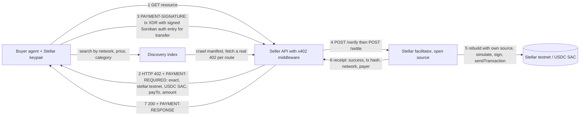
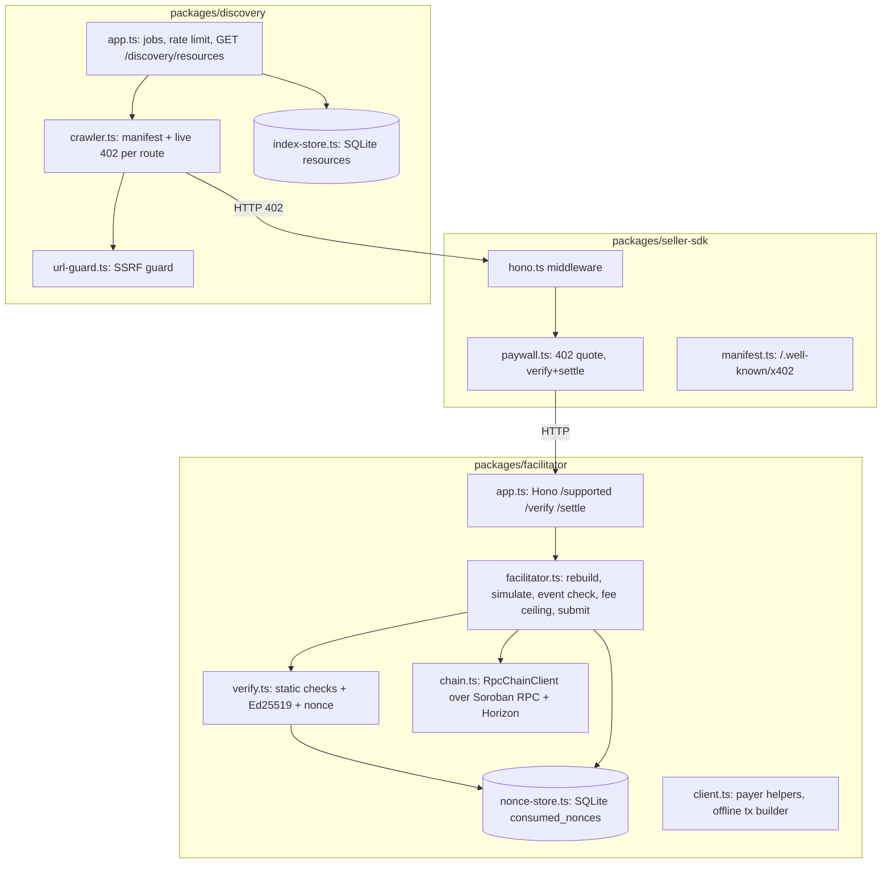

# Architecture

State labels: **REAL** runs against Stellar testnet in `npm run demo:testnet`; **TESTED** has unit tests and no network; **DEMO** is a stand-in; **NOT DEPLOYED** has no public instance.

## Payment flow (REAL on testnet)

The transfer is `transfer(from = buyer, to = seller, amount)` on the token contract. The buyer's authorization entry binds the exact invocation, the network passphrase, a random nonce and an expiry ledger. The facilitator pays the fee and spends its own sequence number; it cannot alter what the buyer authorized and cannot move the buyer's funds anywhere else.

## Components

## Verification order in the facilitator

1. Protocol: `x402Version == 2`, scheme `exact` on both sides, networks match, network is `stellar:*`.
2. Transaction: parses, is not a fee bump, has exactly one `invokeHostFunction`; neither tx source nor op source is a facilitator address.
3. Invocation: contract equals `requirements.asset`; function `transfer` with 3 args; `from` is not the facilitator; `to == payTo`; `amount == requirements.amount` as i128.
4. Authorization entries: at least one; every entry uses `sorobanCredentialsAddress` or `sorobanCredentialsAddressV2` (CAP-71); no facilitator address; no sub-invocations; the authorized invocation equals the operation byte for byte; exactly one entry for `from`.
5. Signature: the payer entry carries one `{public_key, signature}` whose key equals `from`, and the Ed25519 signature verifies over `sha256(HashIdPreimage(network, nonce, expiry, invocation[, address]))`.
6. Nonce: `(network, payer, nonce)` not present in `consumed_nonces`. Checked after the signature (a forged envelope with a spent nonce is `bad_signature`, not `nonce_reused`) and before the expiry window, so a seller re-asking with its claim key after the entry's ledger still reads the recorded outcome (r4 I-r4-2, r5 M-r5-7).
7. Expiry: `currentLedger < signatureExpirationLedger <= currentLedger + ceil(maxTimeoutSeconds / ledgerSeconds) + 2`.
8. Rebuild with the facilitator as source (inclusion fee 100 stroops), simulate on Soroban RPC; the simulation must succeed and `minResourceFee + 100 <= 50,000`.
9. Events: the simulation's contract events contain exactly one `transfer` and it is `from → payTo` for the exact amount on `asset`.
10. Settle only: claim the nonce (atomic insert), assemble with the simulation's footprint and resource fee, sign, `sendTransaction`, poll `getTransaction` until `SUCCESS` or `FAILED`. A `sendTransaction` status of `ERROR` releases the nonce because nothing reached the ledger.

Steps 1–7 are pure functions in `verify.ts` and run in tests with no network. Steps 8–10 go through the `ChainClient` interface; tests substitute `test/mock-chain.ts`, the demo uses `RpcChainClient`.

## Why the token contract and not a custom contract

The SEP-41 interface already provides authorization-bound transfers with replay protection (the nonce is consumed on chain when the entry is applied). A settlement contract adds escrow, fee split and seller-side policy; that is milestone T2 and is deliberately **ABSENT** here so the T1 code path has no contract of ours to audit.

## Data stored

- `consumed_nonces(network, payer, nonce, tx_hash, consumed_at)`: replay guard across restarts. Nothing else about buyers is kept.
- `resources` and `sellers` in the discovery index: public catalogue data only, taken from manifests and live 402 responses.

No private keys are written anywhere by the services. The demo writes its own throwaway testnet keys to a gitignored file so reruns reuse funded accounts.
